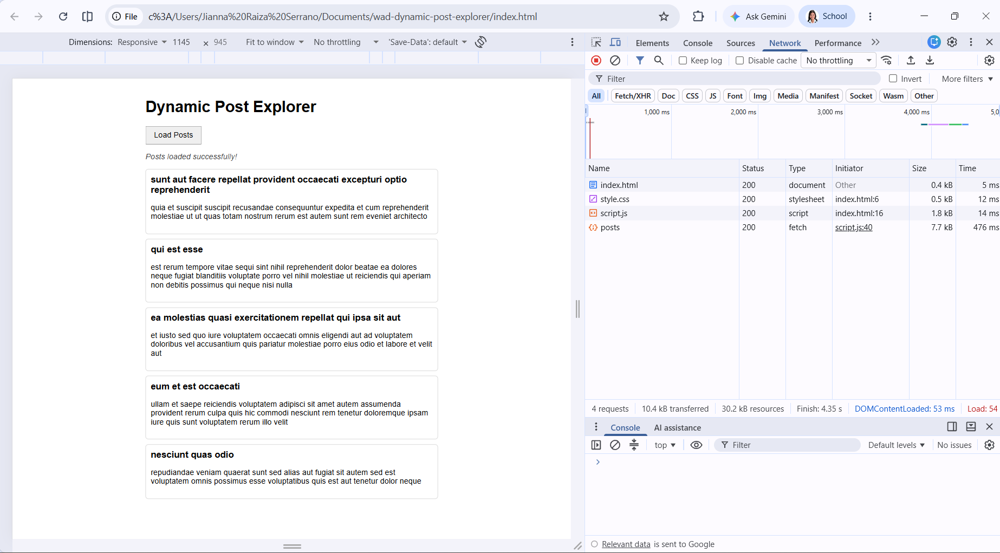
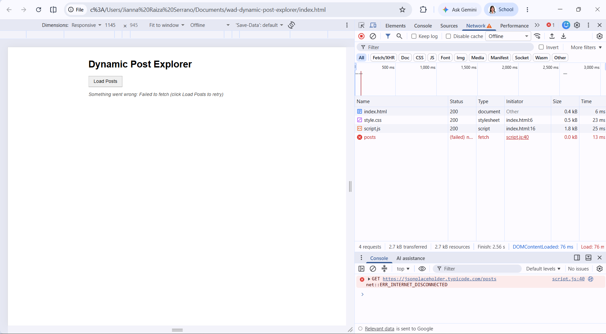
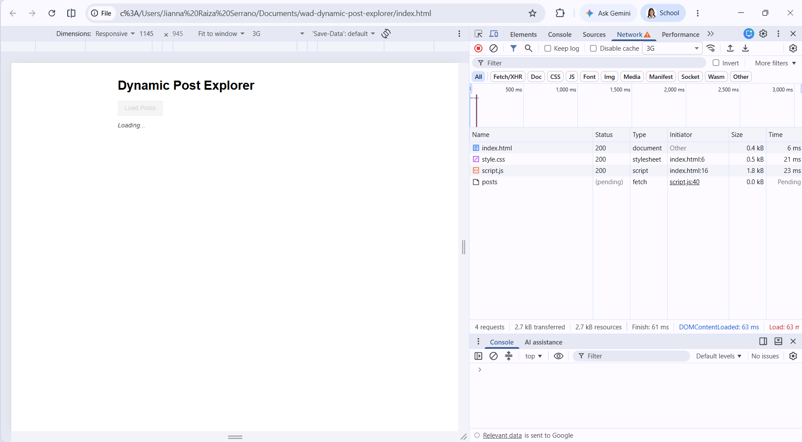

# Dynamic Post Explorer

A small web app that loads blog posts from the JSONPlaceholder API when you click a button. The page never refreshes, everything updates through JavaScript.

Made for **WAD 1 - Week 7: Fetch API & Asynchronous Data**.

## API Used

- Endpoint: `GET /posts`
- Full URL: https://jsonplaceholder.typicode.com/posts

## Features

1. **Load button** - posts are only fetched when the user clicks "Load Posts".
2. **Async/await** - the fetch is written with `async/await`.
3. **First 5 posts only** - I used `slice(0, 5)` on the data.
4. **Safe rendering** - the title and body are added with `textContent`, not `innerHTML`, so no raw HTML gets inserted.
5. **Loading indicator** - "Loading..." shows while the request is running.
6. **Error handling** - network errors and HTTP errors (like 404) show a message on the page.
7. **Retry** - the button is enabled again after a failure, so the user can click it to try again.
8. **No page refresh** - the page updates with the DOM only.

## Project Files

- `index.html` - page structure (heading, button, status text, list)
- `style.css` - basic styling
- `script.js` - fetch logic and DOM rendering
- `screenshots/` - screenshots of the working app

## How to Run

1. Download or clone this repository.
2. Open the folder in VS Code.
3. Run it with a local server (for example, the Live Server extension) so there are no CORS problems.
4. Click **Load Posts**.

## How It Works

1. The user clicks the button.
2. `loadPosts()` disables the button, shows "Loading...", and clears the old list.
3. Inside a `try` block, it waits for `fetch()` and checks `res.ok`. If it's not ok, it throws an error.
4. It parses the response with `res.json()` and keeps the first 5 posts using `slice(0, 5)`.
5. `renderPosts()` loops through the posts with `for...of`, creates the elements, and adds them to the list using `textContent` and `appendChild`.
6. If something fails, the `catch` block shows an error message.
7. The `finally` block always turns the button back on.

## Testing

**Normal click**
- Expected: posts load and 5 posts show on the page.
- Result: Passed

**Repeated clicks**
- Expected: the button is disabled while loading, so no duplicate requests.
- Result: Passed

**Slow network (DevTools throttling)**
- Expected: "Loading..." stays visible during the delay.
- Result: Passed

**Offline mode**
- Expected: the catch block runs and an error message shows.
- Result: Passed

**Empty array (tested by changing the slice to `slice(0, 0)`)**
- Expected: "No posts were found." message shows.
- Result: Passed

## Screenshots

### Success State

### Error State

### Loading State

## What I Learned

- Why network requests need to be asynchronous so the page doesn't freeze.
- That `fetch()` doesn't reject on HTTP errors, so I have to check `res.ok` myself.
- Why `textContent` is safer than `innerHTML` for data coming from an API.
- How `try/catch/finally` helps me manage the loading and error states.

## Author

Serrano, Jianna Raiza DC. - BSIS2 / WAD1